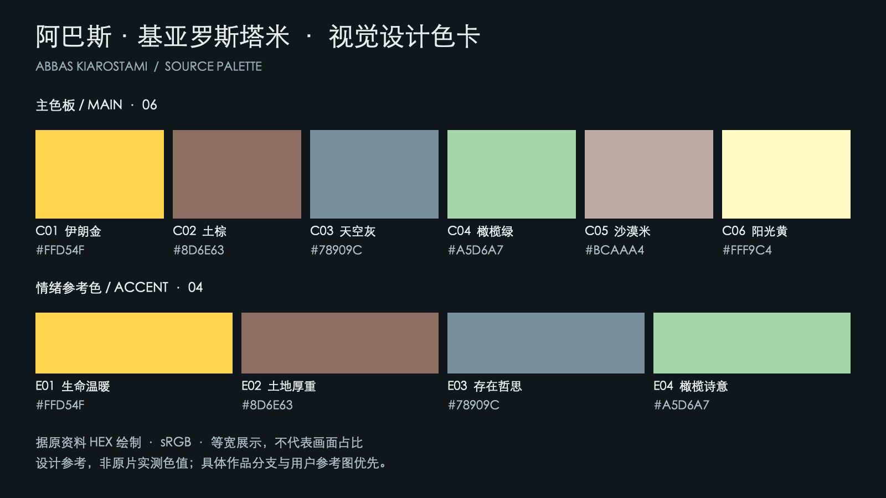

# 阿巴斯·基亚罗斯塔米

**媒介：真人电影。核心机制：道路、车窗与远距离人物让画外空间承担信息。**

## 先选作品分支

《樱桃的滋味》：车窗与干燥山坡；《橄榄树下的情人》：远景人物和乡野路径；《特写》：日常室内与观看关系。

## 转译为画面

- **空间与人物：**道路、车窗与远距离人物让画外空间承担信息。先确定人物位置、视线、动作起止和遮挡关系。
- **光色与材质：**土色和植物色按季节选取，天光保持自然；金黄不是覆盖一切的滤镜。
- **使用边界：**不把简洁误作空泛风景片；不要强制添加奇幻梦境或慢动作。

## 原包色值参考

以下六色仅为原包设计参考，未经逐帧取色验证，不是导演固定参数。按作品和主体选择主、辅、强调色，说明承载物；不规定占比，不把肤色强制映射到色板。黑白分支忽略彩色参考，用户图片优先。

| 原包色名 | HEX |
|---|---|
| 伊朗金 | `#FFD54F` |
| 土棕 | `#8D6E63` |
| 天空灰 | `#78909C` |
| 橄榄绿 | `#A5D6A7` |
| 沙漠米 | `#BCAAA4` |
| 阳光黄 | `#FFF9C4` |

## 原创 showcase 起点

远景中一个人走到土路岔口停住，画外车辆声靠近，人物看向画外。

这是创作提案，不是原片镜头。静帧只取一个可见瞬间；短视频优先围绕一个清楚事件和主导摄影机行为展开。用户需要且时长与能力支持时，可安排合理复合运镜或切镜，并明确衔接和结束状态。

## 来源定位

原包 `第3期_SKILL_动画柔光东方_141-200/10_东方美学与留白意境/194_AbbasKiarostami_阿巴斯·基亚罗斯塔米/色卡主文档.md`。仅抽取色名与色值；作品分支和视觉规则为整理转译，不沿用原包情绪色意义、固定光比或电影截图链接。见 [sources.md](sources.md) 的亚洲扩展说明。

## 可视化色卡与结构化数据

[PNG 色卡](../assets/color-palettes/abbas-kiarostami.png) · [SVG 矢量版](../assets/color-palettes/abbas-kiarostami.svg) · [JSON 色值](../assets/color-palettes/abbas-kiarostami.json)

包含原资料的 6 个主色与 4 个情绪参考色，按 HEX 确定性绘制，非原片逐帧实测。色块等宽仅为查看方便，不代表固定占比；情绪标签只保留原资料联想。使用规则及全库索引见 [色卡使用指南](color-palettes.md)。
