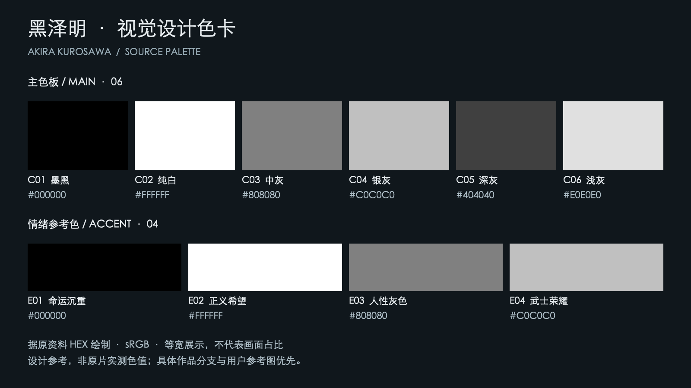

# 黑泽明

**媒介：真人电影。核心机制：通过人物队形、天气和运动方向让冲突在全景中可读。**

## 先选作品分支

《七武士》：黑白雨幕与群体行动；《乱》：彩色服装阵列与地形尺度。

## 转译为画面

- **空间与人物：**通过人物队形、天气和运动方向让冲突在全景中可读。先确定人物位置、视线、动作起止和遮挡关系。
- **光色与材质：**黑白分支按明度分层；彩色分支把对抗色放在服装、旗帜和地形上。原包灰阶不适用于《乱》的彩色设计。
- **使用边界：**不要把黑白片染成泛黄复古色；雨、风必须服务行动。

## 原包色值参考

以下六色仅为原包设计参考，未经逐帧取色验证，不是导演固定参数。按作品和主体选择主、辅、强调色，说明承载物；不规定占比，不把肤色强制映射到色板。黑白分支忽略彩色参考，用户图片优先。

| 原包色名 | HEX |
|---|---|
| 墨黑 | `#000000` |
| 纯白 | `#FFFFFF` |
| 中灰 | `#808080` |
| 银灰 | `#C0C0C0` |
| 深灰 | `#404040` |
| 浅灰 | `#E0E0E0` |

## 原创 showcase 起点

风中坡地，三名旅人停下，其中一人转向坡顶，后方队伍仍在前进。

这是创作提案，不是原片镜头。静帧只取一个可见瞬间；短视频优先围绕一个清楚事件和主导摄影机行为展开。用户需要且时长与能力支持时，可安排合理复合运镜或切镜，并明确衔接和结束状态。

## 来源定位

原包 `第2期_SKILL_浓彩与梦幻_081-140/07_动作史诗与高饱和色彩/124_AkiraKurosawa_黑泽明/色卡主文档.md`。仅抽取色名与色值；作品分支和视觉规则为整理转译，不沿用原包情绪色意义、固定光比或电影截图链接。见 [sources.md](sources.md) 的亚洲扩展说明。

## 可视化色卡与结构化数据

[PNG 色卡](../assets/color-palettes/akira-kurosawa.png) · [SVG 矢量版](../assets/color-palettes/akira-kurosawa.svg) · [JSON 色值](../assets/color-palettes/akira-kurosawa.json)

包含原资料的 6 个主色与 4 个情绪参考色，按 HEX 确定性绘制，非原片逐帧实测。色块等宽仅为查看方便，不代表固定占比；情绪标签只保留原资料联想。使用规则及全库索引见 [色卡使用指南](color-palettes.md)。
