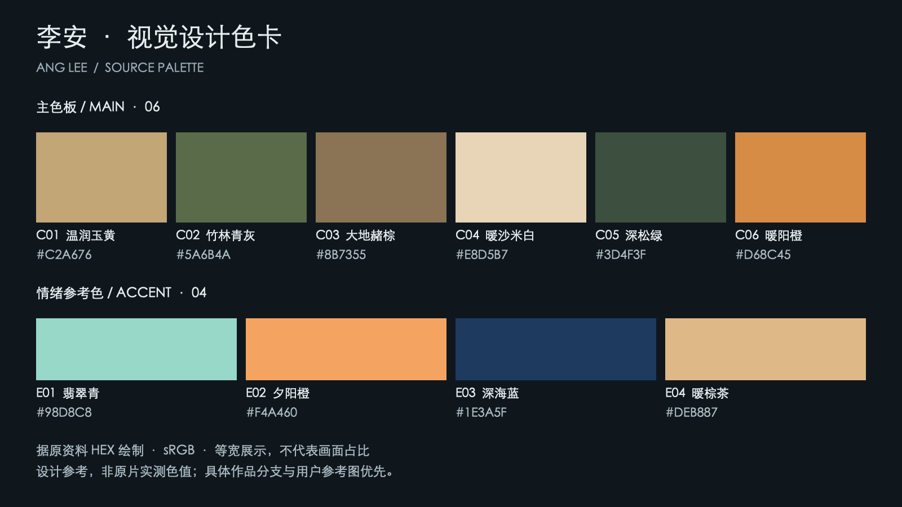

# 李安

**核心机制：人物礼仪与隐秘情感在稳定空间里形成张力。**

## 先选作品分支

《饮食男女》：餐桌秩序与生活动作；《卧虎藏龙》：山水中的轻盈身体；《断背山》：开阔自然与克制情感；《少年派的奇幻漂流》：水面镜像与幻想。

## 转译为画面

- **构图与空间：**以餐桌、门口或地平线分配人物距离；自然风景映照关系，不替代人物行动。
- **光线与材质：**家庭分支用木棕米白与窗光；武侠分支选竹青、岩灰；海洋幻想单独选蓝色与光感，不硬套大地暖黄。
- **人物与时间：**日常场景用拿碗、停筷、转移视线表达压力；武侠动作轻盈但交代起落位置。
- **避免误用：**不能把题材跨度压成统一温柔滤镜；不把克制等同于没有冲突。

以上是依据资料整理的创作方法，不是每部作品都适用的摄影定律。选择一个分支，再根据用户主体组合特征。

## 原包色值参考

下列色名与 HEX 来自原包色板，仅作设计锚点；未经本次逐帧采样验证。挑选主色、辅色和少量强调色，写清颜色承载的物体，不同时塞满全部色彩。作品分支与用户参考图优先于通用色板。

| 原包色名 | HEX |
|---|---|
| 温润玉黄 | `#C2A676` |
| 竹林青灰 | `#5A6B4A` |
| 大地赭棕 | `#8B7355` |
| 暖沙米白 | `#E8D5B7` |
| 深松绿 | `#3D4F3F` |
| 暖阳橙 | `#D68C45` |

## 来源定位

原包条目 `第1期_SKILL_冷调与大地_001-080/03_大地暖调与自然光诗意/045_AngLee_李安` 的 `色卡主文档.md`、`assets/color_palettes/palette.json` 与提示词文件。来源边界及勘误见 [sources.md](sources.md)。

## 可视化色卡与结构化数据

[PNG 色卡](../assets/color-palettes/ang-lee.png) · [SVG 矢量版](../assets/color-palettes/ang-lee.svg) · [JSON 色值](../assets/color-palettes/ang-lee.json)

包含原资料的 6 个主色与 4 个情绪参考色，按 HEX 确定性绘制，非原片逐帧实测。色块等宽仅为查看方便，不代表固定占比；情绪标签只保留原资料联想。使用规则及全库索引见 [色卡使用指南](color-palettes.md)。
