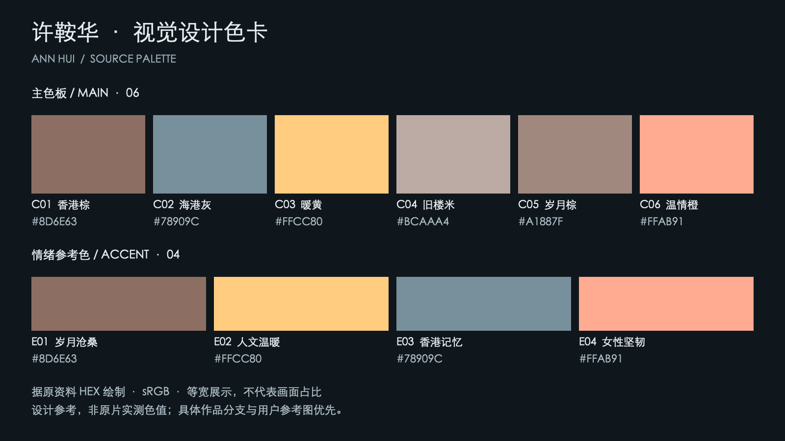

# 许鞍华

**核心机制：日常行动中的照料、距离和生活空间表达人的处境。**

## 先选作品分支

《桃姐》：家居与照护日常；《客途秋恨》：家庭记忆与关系；《姨妈的后现代生活》：生活细节与反差；《黄金时代》：历史人物及时代空间。

## 转译为画面

- **构图与空间：**机位靠近生活节奏，保留饭桌、走廊、窗户与物件的使用关系；不把空间摆成展示间。
- **光线与材质：**自然窗光和室内灯光，棕米灰与适量肤色暖意；历史分支可偏冷褐，不统一温情橙。
- **人物与时间：**收碗、递物、坐下、等待等动作让关系成立；固定或轻微跟随均可，避免表演性摆拍。
- **避免误用：**人文关怀不是暖滤镜，也不等于所有人物都悲苦；不靠煽情音乐代替行动。

以上是依据资料整理的创作方法，不是每部作品都适用的摄影定律。选择一个分支，再根据用户主体组合特征。

## 原包色值参考

下列色名与 HEX 来自原包色板，仅作设计锚点；未经本次逐帧采样验证。挑选主色、辅色和少量强调色，写清颜色承载的物体，不同时塞满全部色彩。作品分支与用户参考图优先于通用色板。

| 原包色名 | HEX |
|---|---|
| 香港棕 | `#8D6E63` |
| 海港灰 | `#78909C` |
| 暖黄 | `#FFCC80` |
| 旧楼米 | `#BCAAA4` |
| 岁月棕 | `#A1887F` |
| 温情橙 | `#FFAB91` |

## 来源定位

原包条目 `第3期_SKILL_动画柔光东方_141-200/10_东方美学与留白意境/187_AnnHui_许鞍华` 的 `色卡主文档.md`、`assets/color_palettes/palette.json` 与提示词文件。来源边界及勘误见 [sources.md](sources.md)。

## 可视化色卡与结构化数据

[PNG 色卡](../assets/color-palettes/ann-hui.png) · [SVG 矢量版](../assets/color-palettes/ann-hui.svg) · [JSON 色值](../assets/color-palettes/ann-hui.json)

包含原资料的 6 个主色与 4 个情绪参考色，按 HEX 确定性绘制，非原片逐帧实测。色块等宽仅为查看方便，不代表固定占比；情绪标签只保留原资料联想。使用规则及全库索引见 [色卡使用指南](color-palettes.md)。
