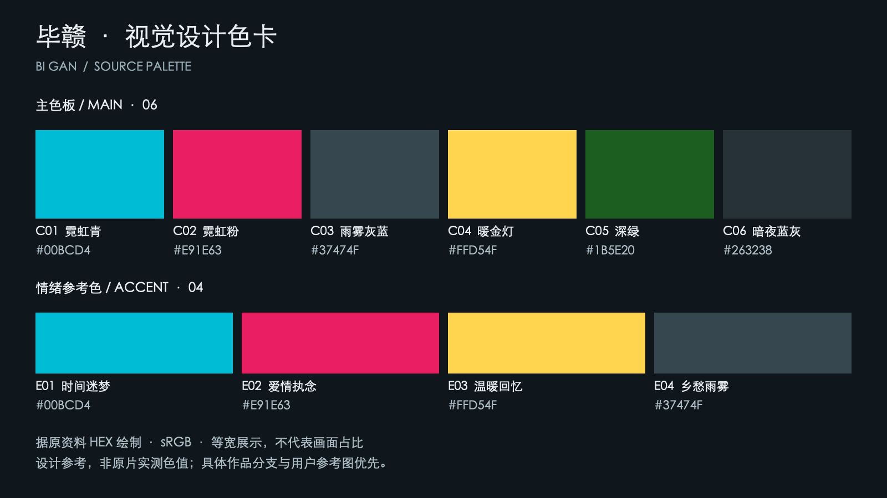

# 毕赣

**核心机制：连续穿行的空间让现实、记忆和梦境互相渗透。**

## 先选作品分支

《路边野餐》：潮湿小城、日常与时间错位；《地球最后的夜晚》：夜色空间、局部色光与梦境游走。

## 转译为画面

- **构图与空间：**用巷道、门洞、台阶与纵深安排从一个空间到另一个空间的路径，空间可变但运动应可理解。
- **光线与材质：**雨雾灰绿与暗蓝为底，局部暖灯或青绿彩光提供方向；《路边野餐》不必霓虹化。
- **人物与时间：**写出镜头起点、跟随对象、转向和终点；短视频只设计一段可完成路径，静帧保留入口与出口暗示。
- **避免误用：**不把“时间迷宫”写成随机瞬移；排除原资料误列的《断·桥》，不将其当毕赣导演作品。

以上是依据资料整理的创作方法，不是每部作品都适用的摄影定律。选择一个分支，再根据用户主体组合特征。

## 代表性示例与人物设计

来源见 [研究记录](research-five-directors.md)。导演谈到早期长镜头也服务于非职业演员的表演空间，后期专业演员需要与复杂调度配合。人物选择不能简化成统一的“神秘美女”。以下均为原创方案。

| 作品分支 | 景别与构图建议 | 色彩与光源落点 | 人物选择与表演建议 |
|---|---|---|---|
| 《路边野餐》 | 中全景／全景，巷口、坡道、门洞相连；静帧可同时显示入口、人物与去路 | 潮湿水泥、植被绿、灰蓝日光与日常服装；不必夜景或霓虹 | 有地方生活感的成年行路人，普通夹克或衬衫、略显迟疑的动作；自然皮肤和身体节奏，避免精致广告妆 |
| 《地球最后的夜晚》 | 中景到全景，人物置于能继续穿行的空间；前景遮挡与深处灯源构成方向，保留梦境般的距离 | 深绿、暗蓝与局部暖灯作为可选设计色，落在墙面、衣料和光源上；不同区域有明暗差 | 带往事感的成年男女，衣着可有黑色电影式造型，疲惫、迟疑或难以读透的凝视；人物首先参与空间调度，再考虑魅力 |

**示例A：坡道尽头的门。** 中全景，一个穿普通夹克的成年男人停在湿润坡道，前景是半开门扇，中景人物回头，后景巷道继续向上。灰蓝日光和植被绿为主，门内一点暖灯；不加雨中霓虹。静帧只画回头瞬间。

**示例B：深夜场所的回望。** 全景，旧室内场所的入口位于前景，成年女性站在中景侧身回望，远处暖灯标出另一个出口；暗绿墙面与暖光相接，人物衣料与墙面可区分。空间似乎还能向深处延展，表情不过度解释故事。

视频可由示例B设计短段跟随：门口起步、人物穿过中景、在灯下停住。只保留实际时长和模型能完成的一段路径。静帧不能声称体现整段长镜头，也不能用任意瞬移替代连续调度。

## 原包色值参考

下列色名与 HEX 来自原包色板，仅作设计锚点；未经本次逐帧采样验证。挑选主色、辅色和少量强调色，写清颜色承载的物体，不同时塞满全部色彩。作品分支与用户参考图优先于通用色板。

| 原包色名 | HEX |
|---|---|
| 霓虹青 | `#00BCD4` |
| 霓虹粉 | `#E91E63` |
| 雨雾灰蓝 | `#37474F` |
| 暖金灯 | `#FFD54F` |
| 深绿 | `#1B5E20` |
| 暗夜蓝灰 | `#263238` |

## 来源定位

原包条目 `第2期_SKILL_浓彩与梦幻_081-140/06_超现实梦幻与心理畸变/117_BiGan_毕赣` 的 `色卡主文档.md`、`assets/color_palettes/palette.json` 与提示词文件。来源边界及勘误见 [sources.md](sources.md)。

## 可视化色卡与结构化数据

[PNG 色卡](../assets/color-palettes/bi-gan.png) · [SVG 矢量版](../assets/color-palettes/bi-gan.svg) · [JSON 色值](../assets/color-palettes/bi-gan.json)

包含原资料的 6 个主色与 4 个情绪参考色，按 HEX 确定性绘制，非原片逐帧实测。色块等宽仅为查看方便，不代表固定占比；情绪标签只保留原资料联想。使用规则及全库索引见 [色卡使用指南](color-palettes.md)。
