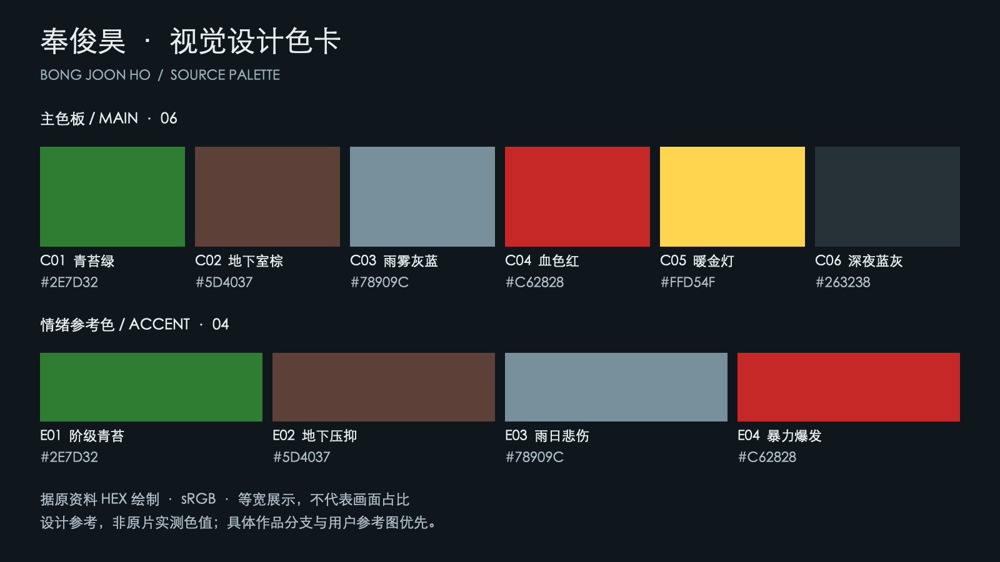

# 奉俊昊

**媒介：真人电影。核心机制：建筑高低与出入口将人物关系组织成可见障碍。**

## 先选作品分支

《寄生虫》：楼梯、门槛与高低空间；《杀人回忆》：乡野日常与搜寻；《雪国列车》：狭长空间和层级。

## 转译为画面

- **空间与人物：**建筑高低与出入口将人物关系组织成可见障碍。先确定人物位置、视线、动作起止和遮挡关系。
- **光色与材质：**上下层可有不同光质和材料，但颜色由场景来源决定；保持日常物件的真实感。
- **使用边界：**不把社会关系简化成固定阶级颜色；不把所有分支做成高饱和奇观。

## 原包色值参考

以下六色仅为原包设计参考，未经逐帧取色验证，不是导演固定参数。按作品和主体选择主、辅、强调色，说明承载物；不规定占比，不把肤色强制映射到色板。黑白分支忽略彩色参考，用户图片优先。

| 原包色名 | HEX |
|---|---|
| 青苔绿 | `#2E7D32` |
| 地下室棕 | `#5D4037` |
| 雨雾灰蓝 | `#78909C` |
| 血色红 | `#C62828` |
| 暖金灯 | `#FFD54F` |
| 深夜蓝灰 | `#263238` |

## 原创 showcase 起点

送货者停在楼梯下方，楼上门打开，光落到台阶却没有照到他的脸。

这是创作提案，不是原片镜头。静帧只取一个可见瞬间；短视频优先围绕一个清楚事件和主导摄影机行为展开。用户需要且时长与能力支持时，可安排合理复合运镜或切镜，并明确衔接和结束状态。

## 来源定位

原包 `第2期_SKILL_浓彩与梦幻_081-140/07_动作史诗与高饱和色彩/139_BongJoon-ho_奉俊昊/色卡主文档.md`。仅抽取色名与色值；作品分支和视觉规则为整理转译，不沿用原包情绪色意义、固定光比或电影截图链接。见 [sources.md](sources.md) 的亚洲扩展说明。

## 可视化色卡与结构化数据

[PNG 色卡](../assets/color-palettes/bong-joon-ho.png) · [SVG 矢量版](../assets/color-palettes/bong-joon-ho.svg) · [JSON 色值](../assets/color-palettes/bong-joon-ho.json)

包含原资料的 6 个主色与 4 个情绪参考色，按 HEX 确定性绘制，非原片逐帧实测。色块等宽仅为查看方便，不代表固定占比；情绪标签只保留原资料联想。使用规则及全库索引见 [色卡使用指南](color-palettes.md)。
