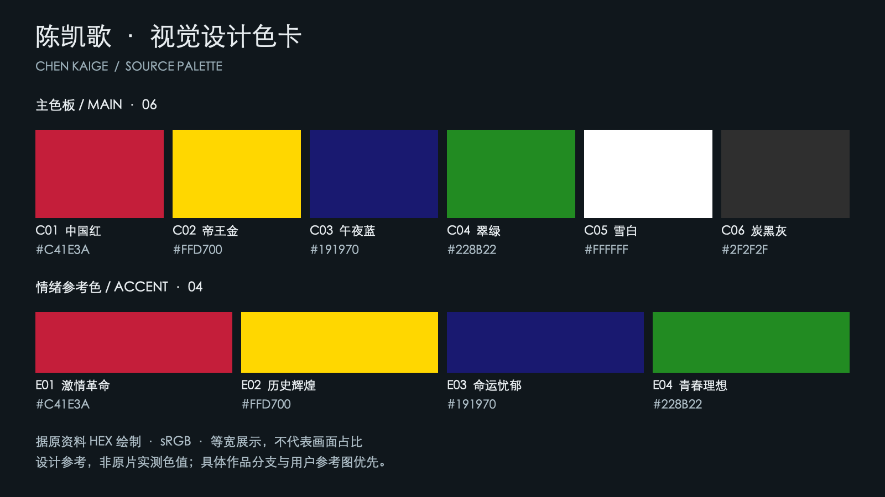

# 陈凯歌

**核心机制：人物身份与历史空间、舞台内外形成戏剧关系。**

## 先选作品分支

《霸王别姬》：戏台浓彩与后台现实；《黄土地》：土地尺度和人物处境；《荆轲刺秦王》：历史建筑与权力；《妖猫传》：繁华灯火与幻象。

## 转译为画面

- **构图与空间：**戏曲分支让帷幕、台口、后台与观看者构成层次；土地分支关注人物在大地中的尺度。
- **光线与材质：**戏台聚光落在妆面与服饰，后台降低装饰性；史诗或幻象分支再选择金红，不统一华丽。
- **人物与时间：**用换装、停步、回望或跨过帷幕让身份转变可见；移动镜头需有空间和情绪目标。
- **避免误用：**不要把第五代、文化反思当成运镜；不要将《黄土地》改成宫廷浓彩。

以上是依据资料整理的创作方法，不是每部作品都适用的摄影定律。选择一个分支，再根据用户主体组合特征。

## 代表性示例与人物设计

来源见 [研究记录](research-five-directors.md)。分开处理《黄土地》的克制地景和《霸王别姬》的戏台／历史空间；下列为原创方案。《黄土地》导演为陈凯歌、摄影为张艺谋，须正确区分署名。

| 作品分支 | 景别与构图建议 | 色彩与光源落点 | 人物选择与表演建议 |
|---|---|---|---|
| 《黄土地》 | 大远景，土地占主要面积，人物与地形的尺度差建立关系；固定观看与简化几何 | 黄褐土地、灰蓝或深色衣料、受限色彩与自然光；不加宫廷红金 | 与时代、乡村生活相符的人物，朴素棉布、自然身体姿态；年龄根据故事确定，不默认精致成年女模 |
| 《霸王别姬》 | 中景保留身段与手势，全景呈现戏台；门框、帘幕、镜面组织台前台后关系 | 戏服上的红、金等局部丰富颜色与暗木后台相对；舞台光和后台光分区 | 戏曲表演者须明确行当与妆扮；若参考程蝶衣式角色，设定为成年男性旦角表演者，不能仅写成古装美女；身段、眼神、手指动作需与角色相符 |

**示例A：土地中的行路人。** 大远景，黄褐坡地占画面大部，一位穿深色棉布衣的人沿坡缘前行，人物很小但轮廓清楚。自然光、少量天空与克制色彩形成尺度压力。这是新的地景方案，不标为原片截图。

**示例B：上场前的停顿。** 中景，成年男性旦角表演者站在后台帘边，戏服与妆容完整，抬手整理袖口；前景帘幕、人物、远处明亮戏台形成三层。红与金落在戏服上，后台是暗木棕；目光朝舞台，动作有训练痕迹。重点是身份、表演和场所关系。

检验戏曲服装、头饰与手势是否属于同一语境，不能将京剧、昆曲和泛古装随机拼接。繁复服饰仅适用于相应分支；《黄土地》不继承华丽戏台视觉。

## 原包色值参考

下列色名与 HEX 来自原包色板，仅作设计锚点；未经本次逐帧采样验证。挑选主色、辅色和少量强调色，写清颜色承载的物体，不同时塞满全部色彩。作品分支与用户参考图优先于通用色板。

| 原包色名 | HEX |
|---|---|
| 中国红 | `#C41E3A` |
| 帝王金 | `#FFD700` |
| 午夜蓝 | `#191970` |
| 翠绿 | `#228B22` |
| 雪白 | `#FFFFFF` |
| 炭黑灰 | `#2F2F2F` |

## 来源定位

原包条目 `第2期_SKILL_浓彩与梦幻_081-140/05_巴洛克华丽与浓墨重彩/096_ChenKaige_陈凯歌` 的 `色卡主文档.md`、`assets/color_palettes/palette.json` 与提示词文件。来源边界及勘误见 [sources.md](sources.md)。

## 可视化色卡与结构化数据

[PNG 色卡](../assets/color-palettes/chen-kaige.png) · [SVG 矢量版](../assets/color-palettes/chen-kaige.svg) · [JSON 色值](../assets/color-palettes/chen-kaige.json)

包含原资料的 6 个主色与 4 个情绪参考色，按 HEX 确定性绘制，非原片逐帧实测。色块等宽仅为查看方便，不代表固定占比；情绪标签只保留原资料联想。使用规则及全库索引见 [色卡使用指南](color-palettes.md)。
