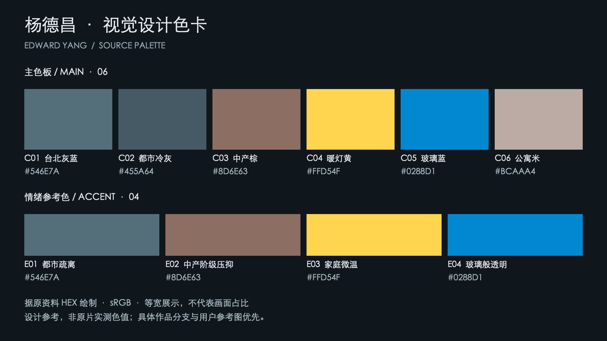

# 杨德昌

**核心机制：城市几何和多人物距离使人际关系可见。**

## 先选作品分支

《一一》：家庭、公寓与城市反射；《恐怖分子》：隔断与陌生人关系；《独立时代》：都市群体；《牯岭街少年杀人事件》：1960年代台北的空间与青春。

## 转译为画面

- **构图与空间：**用玻璃、门口、道路及不同房间分隔人物，保留多人处在同一画面的关系信息。
- **光线与材质：**灰蓝建筑、室内米棕与局部灯光形成层次；真实混合光优先于统一冷色滤镜。
- **人物与时间：**用人物进出、错过视线和画外声音推动信息变化，稳定中远景容纳关系。
- **避免误用：**多线叙事不是镜头运动；不用浅景深把重要环境全部虚化；原包“50年代”不沿用。

以上是依据资料整理的创作方法，不是每部作品都适用的摄影定律。选择一个分支，再根据用户主体组合特征。

## 原包色值参考

下列色名与 HEX 来自原包色板，仅作设计锚点；未经本次逐帧采样验证。挑选主色、辅色和少量强调色，写清颜色承载的物体，不同时塞满全部色彩。作品分支与用户参考图优先于通用色板。

| 原包色名 | HEX |
|---|---|
| 台北灰蓝 | `#546E7A` |
| 都市冷灰 | `#455A64` |
| 中产棕 | `#8D6E63` |
| 暖灯黄 | `#FFD54F` |
| 玻璃蓝 | `#0288D1` |
| 公寓米 | `#BCAAA4` |

## 来源定位

原包条目 `第3期_SKILL_动画柔光东方_141-200/10_东方美学与留白意境/186_EdwardYang_杨德昌` 的 `色卡主文档.md`、`assets/color_palettes/palette.json` 与提示词文件。来源边界及勘误见 [sources.md](sources.md)。

## 可视化色卡与结构化数据

[PNG 色卡](../assets/color-palettes/edward-yang.png) · [SVG 矢量版](../assets/color-palettes/edward-yang.svg) · [JSON 色值](../assets/color-palettes/edward-yang.json)

包含原资料的 6 个主色与 4 个情绪参考色，按 HEX 确定性绘制，非原片逐帧实测。色块等宽仅为查看方便，不代表固定占比；情绪标签只保留原资料联想。使用规则及全库索引见 [色卡使用指南](color-palettes.md)。
