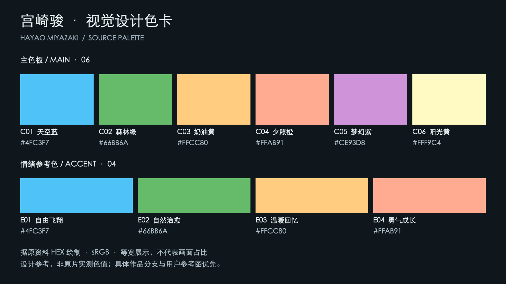

# 宫崎骏

**媒介：动画。核心机制：手绘环境、具有重量的劳动和自然运动构成世界。**

## 先选作品分支

《龙猫》：乡间生活与自然；《魔女宅急便》：城市劳动与飞行；《幽灵公主》：森林与工业空间。

## 转译为画面

- **空间与人物：**手绘环境、具有重量的劳动和自然运动构成世界。先确定人物位置、视线、动作起止和遮挡关系。
- **光色与材质：**天空蓝、植物绿和土木色由背景绘制承载；阴影用有色平涂分层，不套真人胶片噪点。
- **使用边界：**原创角色与生物，不复制标志角色；飞行也要有方向、阻力和落点。

## 原包色值参考

以下六色仅为原包设计参考，未经逐帧取色验证，不是导演固定参数。按作品和主体选择主、辅、强调色，说明承载物；不规定占比，不把肤色强制映射到色板。黑白分支忽略彩色参考，用户图片优先。

| 原包色名 | HEX |
|---|---|
| 天空蓝 | `#4FC3F7` |
| 森林绿 | `#66BB6A` |
| 奶油黄 | `#FFCC80` |
| 夕照橙 | `#FFAB91` |
| 梦幻紫 | `#CE93D8` |
| 阳光黄 | `#FFF9C4` |

## 原创 showcase 起点

原创修理工在山坡工作台上放下工具，风鼓起晾晒的布，远处云影掠过田地。

这是创作提案，不是原片镜头。静帧只取一个可见瞬间；短视频优先围绕一个清楚事件和主导摄影机行为展开。用户需要且时长与能力支持时，可安排合理复合运镜或切镜，并明确衔接和结束状态。

## 来源定位

原包 `第2期_SKILL_浓彩与梦幻_081-140/07_动作史诗与高饱和色彩/126_HayaoMiyazaki_宫崎骏/色卡主文档.md`。仅抽取色名与色值；作品分支和视觉规则为整理转译，不沿用原包情绪色意义、固定光比或电影截图链接。见 [sources.md](sources.md) 的亚洲扩展说明。

## 可视化色卡与结构化数据

[PNG 色卡](../assets/color-palettes/hayao-miyazaki.png) · [SVG 矢量版](../assets/color-palettes/hayao-miyazaki.svg) · [JSON 色值](../assets/color-palettes/hayao-miyazaki.json)

包含原资料的 6 个主色与 4 个情绪参考色，按 HEX 确定性绘制，非原片逐帧实测。色块等宽仅为查看方便，不代表固定占比；情绪标签只保留原资料联想。使用规则及全库索引见 [色卡使用指南](color-palettes.md)。
