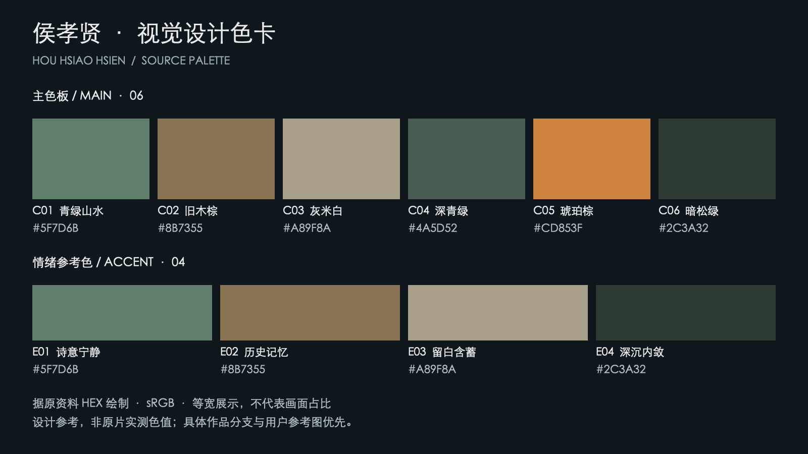

# 侯孝贤

**核心机制：保持观看距离，让人物关系在纵深和时间中显现。**

## 先选作品分支

《悲情城市》：家族空间与历史记忆；《童年往事》：庭院生活；《海上花》：室内灯火与缓慢流动；《刺客聂隐娘》：帷幕、山水与隐匿。

## 转译为画面

- **构图与空间：**门窗与帘幕构成多层空间，人物在中远景进入或离开；保留画外发生事件的余地。
- **光线与材质：**乡土分支用自然光与木土色；《海上花》用暖暗灯火；《刺客聂隐娘》重青绿山水与室内深色层次。
- **人物与时间：**固定观察或缓缓横移，让人物走位改变构图；不要求每个情绪都有正反打特写。
- **避免误用：**不能把所有作品一律青绿留白；也不能把静观理解为完全没有调度。

以上是依据资料整理的创作方法，不是每部作品都适用的摄影定律。选择一个分支，再根据用户主体组合特征。

## 原包色值参考

下列色名与 HEX 来自原包色板，仅作设计锚点；未经本次逐帧采样验证。挑选主色、辅色和少量强调色，写清颜色承载的物体，不同时塞满全部色彩。作品分支与用户参考图优先于通用色板。

| 原包色名 | HEX |
|---|---|
| 青绿山水 | `#5F7D6B` |
| 旧木棕 | `#8B7355` |
| 灰米白 | `#A89F8A` |
| 深青绿 | `#4A5D52` |
| 琥珀棕 | `#CD853F` |
| 暗松绿 | `#2C3A32` |

## 来源定位

原包条目 `第2期_SKILL_浓彩与梦幻_081-140/05_巴洛克华丽与浓墨重彩/099_HouHsiao-hsien_侯孝贤` 的 `色卡主文档.md`、`assets/color_palettes/palette.json` 与提示词文件。来源边界及勘误见 [sources.md](sources.md)。

## 可视化色卡与结构化数据

[PNG 色卡](../assets/color-palettes/hou-hsiao-hsien.png) · [SVG 矢量版](../assets/color-palettes/hou-hsiao-hsien.svg) · [JSON 色值](../assets/color-palettes/hou-hsiao-hsien.json)

包含原资料的 6 个主色与 4 个情绪参考色，按 HEX 确定性绘制，非原片逐帧实测。色块等宽仅为查看方便，不代表固定占比；情绪标签只保留原资料联想。使用规则及全库索引见 [色卡使用指南](color-palettes.md)。
