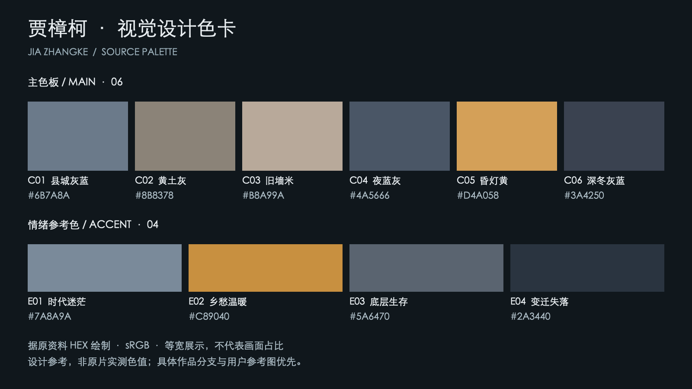

# 贾樟柯

**核心机制：人物与社会空间同框，日常细节显出时代变化。**

## 先选作品分支

《小武》：县城街道与游移人物；《站台》：演出、交通与年代变化；《三峡好人》：人、江面与拆迁空间；《世界》：舞台繁华与生活反差；《山河故人》：人物与生活空间的尺度、交通与日常物件、场景之间有差别的冷暖与鲜色。

涉及《山河故人》的配色、质感、人物尺度与环境关系时，必读 [用户参考图的场景级补充](jia-zhangke-mountains-may-depart-user-studies.md)。按六类场景选择，不将灰暗县城、低饱和或远景当作唯一风格；网络拼图不证明原片画幅变化、镜头顺序或声音。

## 转译为画面

- **构图与空间：**用中远景保留招牌、道路、房屋与人的尺度关系，人物可以不在画面中心。
- **光线与材质：**自然天光、灰蓝旧墙与局部生活色；演出和夜场可鲜艳，不把所有场景统一去饱和。
- **人物与时间：**让行走、等车、抽身离开或劳动自然展开；环境声和时代音乐作为叙事线索，音乐使用另按授权处理。
- **避免误用：**不以脏乱贫困等同真实，不强行加入故乡、废墟或霓虹；保留用户主体身份。

以上是依据资料整理的创作方法，不是每部作品都适用的摄影定律。选择一个分支，再根据用户主体组合特征。

## 代表性示例与人物设计

来源见 [研究记录](research-five-directors.md)。导演访谈支持远景、长镜头给予观众观察自由；早期非职业演员经验不等于所有作品只用非职业演员。以下人物与场景为原创创作建议。

| 作品分支 | 景别与构图建议 | 色彩与光源落点 | 人物选择与表演建议 |
|---|---|---|---|
| 《三峡好人》 | 中全景／远景，让人物、江面、拆迁建筑同时可读；保留前中后景与横向生活活动 | 雾中江水灰绿、水泥灰、日常衣服的少量颜色；自然散射光，不强制全片灰黄 | 有生活经验感的成年劳动者或寻人者；合身程度不一的日常衣物，真实皮肤、站姿和负重；不把所有人做成衰老、肮脏或悲惨表情 |
| 《山河故人》 | 按场景选人物与河岸街巷同框、夜路小尺度人物、草场车辆远景或双人近景；生活物件和空间同样重要 | 冷色河岸与局部红、深蓝夜色与小火光、暖光绿坡、米黄车身、墨绿座椅与黄色行李箱分别选用；不统一去饱和 | 保留用户身份、年代和人物关系；以位置、朝向、共同停留和日常物件表达关系，不凭场景推断贫困、职业或亲属身份 |
| 《站台》 | 群像全景，县城舞台、院墙或道路与人物并重；人物之间留出可读距离 | 砖土、旧墙、时代服装与演出服上的局部鲜色 | 县城文艺青年／表演者群体，时代发型与日常身体习惯；台上表演和台下等待有差别，不是一排时装模特 |

**示例A：江边等消息。** 中全景，成年寻人者站在旧建筑旁，手握折起的纸条；江面和远处施工痕迹仍可辨，另一位路人在中景经过。灰绿江水、水泥墙、衣服上低饱和蓝构成画面。表情内敛，视线落向有人活动的方向，环境承担叙事。

**示例B：县城演出后的空场。** 固定全景，几名年轻成年表演者在简易舞台边收拾物件，一人仍穿演出外套，其他人换回便装。旧墙、舞台布和散落道具保留时代信息；人物有各自行动，避免整齐面向镜头。

景别不等于冷漠，生活感不等于低清晰度或刻意脏污。需要近景时保留能说明地点的环境线索。避免把社会处境简化为某种脸型、地域相貌或贫困奇观；也不能删掉作品中的鲜色、表演性或超现实可能。

## 原包色值参考

下列色名与 HEX 来自原包色板，仅作设计锚点；未经本次逐帧采样验证。挑选主色、辅色和少量强调色，写清颜色承载的物体，不同时塞满全部色彩。作品分支、用户参考图及对应场景补充优先于通用色板。《山河故人》的暖绿、米黄与局部鲜色不可被旧灰蓝／黄土色板抹去；不将原包色名视为全片默认配方。

| 原包色名 | HEX |
|---|---|
| 县城灰蓝 | `#6B7A8A` |
| 黄土灰 | `#8B8378` |
| 旧墙米 | `#B8A99A` |
| 夜蓝灰 | `#4A5666` |
| 昏灯黄 | `#D4A058` |
| 深冬灰蓝 | `#3A4250` |

## 来源定位

原包条目 `第1期_SKILL_冷调与大地_001-080/04_极简冷构与静观长镜/073_JiaZhangke_贾樟柯` 的 `色卡主文档.md`、`assets/color_palettes/palette.json` 与提示词文件。来源边界及勘误见 [sources.md](sources.md)。

## 可视化色卡与结构化数据

[PNG 色卡](../assets/color-palettes/jia-zhangke.png) · [SVG 矢量版](../assets/color-palettes/jia-zhangke.svg) · [JSON 色值](../assets/color-palettes/jia-zhangke.json)

包含原资料的 6 个主色与 4 个情绪参考色，按 HEX 确定性绘制，非原片逐帧实测。色块等宽仅为查看方便，不代表固定占比；情绪标签只保留原资料联想。使用规则及全库索引见 [色卡使用指南](color-palettes.md)。
