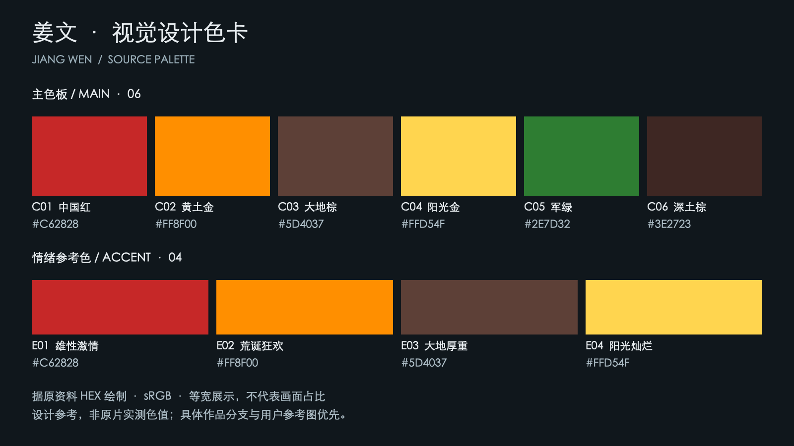

# 姜文

**核心机制：强烈身体姿态、权力站位与节奏制造荒诞感。**

## 先选作品分支

《阳光灿烂的日子》：灼热青春与记忆；《鬼子来了》：以黑白为主的荒诞压力；《太阳照常升起》：跳跃意象与浓烈环境；《让子弹飞》：群体对峙与权力空间。

## 转译为画面

- **构图与空间：**以高低机位、群体站位和人物间距强化谁控制局面；荒诞来自关系和行为的不协调。
- **光线与材质：**青春分支可用强日光、军绿与暖色；《鬼子来了》不能套红金饱和模板。
- **人物与时间：**让突然停顿、集体转头、向前一步改变场面力量；对白、切镜和反应互相配合。
- **避免误用：**不靠“雄性荷尔蒙”替代具体表演，也不擅自把主体改成男性群像。

以上是依据资料整理的创作方法，不是每部作品都适用的摄影定律。选择一个分支，再根据用户主体组合特征。

## 原包色值参考

下列色名与 HEX 来自原包色板，仅作设计锚点；未经本次逐帧采样验证。挑选主色、辅色和少量强调色，写清颜色承载的物体，不同时塞满全部色彩。作品分支与用户参考图优先于通用色板。

| 原包色名 | HEX |
|---|---|
| 中国红 | `#C62828` |
| 黄土金 | `#FF8F00` |
| 大地棕 | `#5D4037` |
| 阳光金 | `#FFD54F` |
| 军绿 | `#2E7D32` |
| 深土棕 | `#3E2723` |

## 来源定位

原包条目 `第2期_SKILL_浓彩与梦幻_081-140/07_动作史诗与高饱和色彩/123_JiangWen_姜文` 的 `色卡主文档.md`、`assets/color_palettes/palette.json` 与提示词文件。来源边界及勘误见 [sources.md](sources.md)。

## 可视化色卡与结构化数据

[PNG 色卡](../assets/color-palettes/jiang-wen.png) · [SVG 矢量版](../assets/color-palettes/jiang-wen.svg) · [JSON 色值](../assets/color-palettes/jiang-wen.json)

包含原资料的 6 个主色与 4 个情绪参考色，按 HEX 确定性绘制，非原片逐帧实测。色块等宽仅为查看方便，不代表固定占比；情绪标签只保留原资料联想。使用规则及全库索引见 [色卡使用指南](color-palettes.md)。
