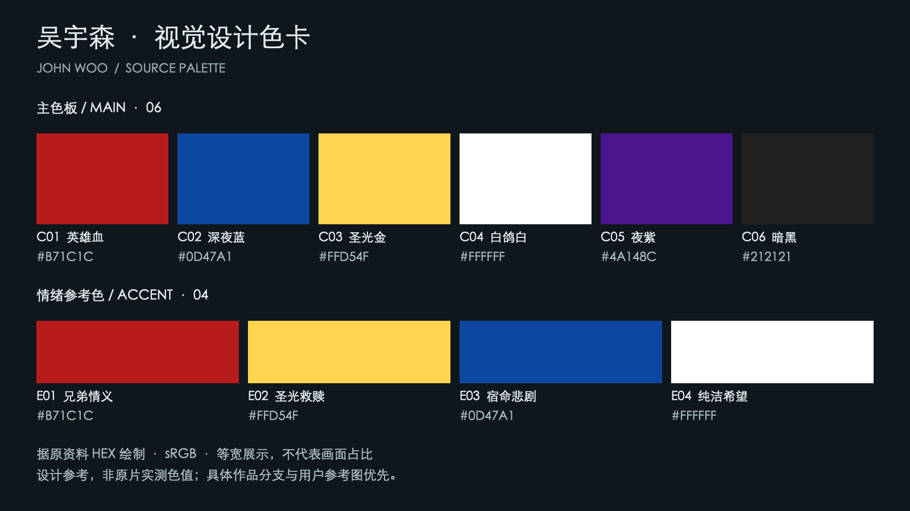

# 吴宇森

**核心机制：人物对峙、共同动作和牺牲姿态构成浪漫动作戏。**

## 先选作品分支

《英雄本色》：关系与城市行动；《喋血双雄》：空间对峙与仪式；《变脸》：身份镜像；《赤壁》：集体战阵与火光。

## 转译为画面

- **构图与空间：**先建立人物视线、遮蔽物和动作轴线，再以并置、对峙或横向展开表现关系。
- **光线与材质：**夜蓝、暗色与局部暖光形成冷暖层次，白衣或亮色提供轮廓；场景需要时才加火光。
- **人物与时间：**慢动作强调选择、转身、掩护或落点；人物和环境反应一致，剪辑不得让方位无故跳变。
- **避免误用：**白鸽、教堂和双枪是可选意象；不把普通慢镜写成环绕冻结的“子弹时间”。

以上是依据资料整理的创作方法，不是每部作品都适用的摄影定律。选择一个分支，再根据用户主体组合特征。

## 原包色值参考

下列色名与 HEX 来自原包色板，仅作设计锚点；未经本次逐帧采样验证。挑选主色、辅色和少量强调色，写清颜色承载的物体，不同时塞满全部色彩。作品分支与用户参考图优先于通用色板。

| 原包色名 | HEX |
|---|---|
| 英雄血 | `#B71C1C` |
| 深夜蓝 | `#0D47A1` |
| 圣光金 | `#FFD54F` |
| 白鸽白 | `#FFFFFF` |
| 夜紫 | `#4A148C` |
| 暗黑 | `#212121` |

## 来源定位

原包条目 `第2期_SKILL_浓彩与梦幻_081-140/07_动作史诗与高饱和色彩/122_JohnWoo_吴宇森` 的 `色卡主文档.md`、`assets/color_palettes/palette.json` 与提示词文件。来源边界及勘误见 [sources.md](sources.md)。

## 可视化色卡与结构化数据

[PNG 色卡](../assets/color-palettes/john-woo.png) · [SVG 矢量版](../assets/color-palettes/john-woo.svg) · [JSON 色值](../assets/color-palettes/john-woo.json)

包含原资料的 6 个主色与 4 个情绪参考色，按 HEX 确定性绘制，非原片逐帧实测。色块等宽仅为查看方便，不代表固定占比；情绪标签只保留原资料联想。使用规则及全库索引见 [色卡使用指南](color-palettes.md)。
