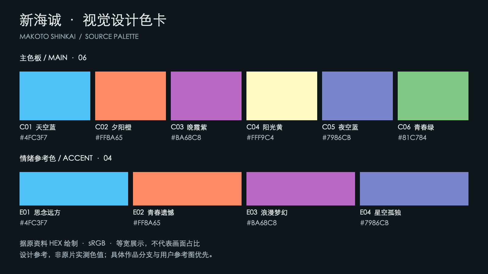

# 新海诚

**媒介：动画。核心机制：精细背景、天气光线与人物尺度让距离可见。**

## 先选作品分支

《秒速5厘米》：距离、交通与季节；《言叶之庭》：雨、叶与湿表面；《天气之子》：城市天气和天光变化。

## 转译为画面

- **空间与人物：**精细背景、天气光线与人物尺度让距离可见。先确定人物位置、视线、动作起止和遮挡关系。
- **光色与材质：**天空与云层控制冷暖，反射跟随实际光源；只选一种天气和时段。
- **使用边界：**不把每个画面都做成夕阳彗星；光晕不能掩盖透视，人物采用原创设计。

## 原包色值参考

以下六色仅为原包设计参考，未经逐帧取色验证，不是导演固定参数。按作品和主体选择主、辅、强调色，说明承载物；不规定占比，不把肤色强制映射到色板。黑白分支忽略彩色参考，用户图片优先。

| 原包色名 | HEX |
|---|---|
| 天空蓝 | `#4FC3F7` |
| 夕阳橙 | `#FF8A65` |
| 晚霞紫 | `#BA68C8` |
| 阳光黄 | `#FFF9C4` |
| 夜空蓝 | `#7986CB` |
| 青春绿 | `#81C784` |

## 原创 showcase 起点

雨后天桥上两人隔着栏杆站立，一小片阳光移到积水中，远处列车驶过。

这是创作提案，不是原片镜头。静帧只取一个可见瞬间；短视频优先围绕一个清楚事件和主导摄影机行为展开。用户需要且时长与能力支持时，可安排合理复合运镜或切镜，并明确衔接和结束状态。

## 来源定位

原包 `第3期_SKILL_动画柔光东方_141-200/08_动画奇幻与异想视觉/144_MakotoShinkai_新海诚/色卡主文档.md`。仅抽取色名与色值；作品分支和视觉规则为整理转译，不沿用原包情绪色意义、固定光比或电影截图链接。见 [sources.md](sources.md) 的亚洲扩展说明。

## 可视化色卡与结构化数据

[PNG 色卡](../assets/color-palettes/makoto-shinkai.png) · [SVG 矢量版](../assets/color-palettes/makoto-shinkai.svg) · [JSON 色值](../assets/color-palettes/makoto-shinkai.json)

包含原资料的 6 个主色与 4 个情绪参考色，按 HEX 确定性绘制，非原片逐帧实测。色块等宽仅为查看方便，不代表固定占比；情绪标签只保留原资料联想。使用规则及全库索引见 [色卡使用指南](color-palettes.md)。
