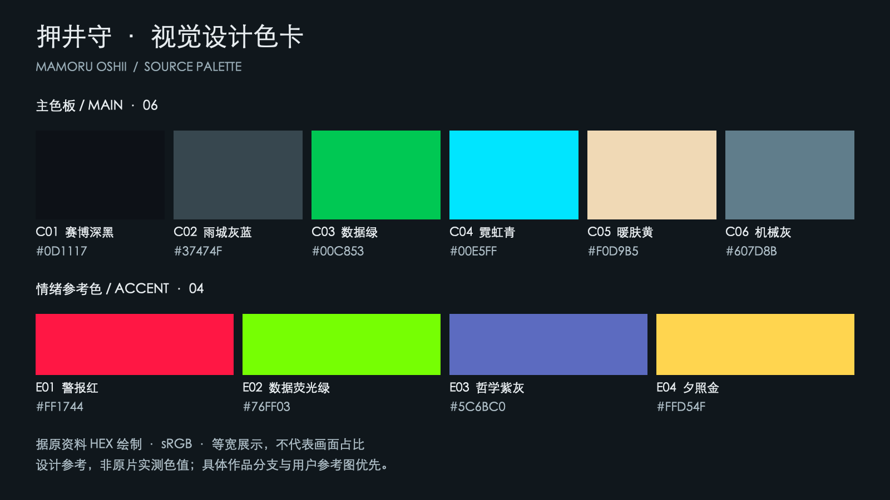

# 押井守

**媒介：动画。核心机制：城市层次、倒影与静止身体把人工环境变成观看对象。**

## 先选作品分支

《攻壳机动队》剧场版：城市反射与身体；《天使之卵》：荒凉建筑与沉默；《空中杀手》：基地与重复日常。

## 转译为画面

- **空间与人物：**城市层次、倒影与静止身体把人工环境变成观看对象。先确定人物位置、视线、动作起止和遮挡关系。
- **光色与材质：**灰蓝用于建筑与机械，少量暖光对应室内来源；《天使之卵》不沿用通用霓虹赛博配色。
- **使用边界：**原包跨系列素材不自动归入本人作品；不默认数据雨、全息广告或复制角色。

## 原包色值参考

以下六色仅为原包设计参考，未经逐帧取色验证，不是导演固定参数。按作品和主体选择主、辅、强调色，说明承载物；不规定占比，不把肤色强制映射到色板。黑白分支忽略彩色参考，用户图片优先。

| 原包色名 | HEX |
|---|---|
| 赛博深黑 | `#0D1117` |
| 雨城灰蓝 | `#37474F` |
| 数据绿 | `#00C853` |
| 霓虹青 | `#00E5FF` |
| 暖肤黄 | `#F0D9B5` |
| 机械灰 | `#607D8B` |

## 原创 showcase 起点

原创信使站在空渡口，窗玻璃映出缓慢经过的船影，人物与倒影不完全重合。

这是创作提案，不是原片镜头。静帧只取一个可见瞬间；短视频优先围绕一个清楚事件和主导摄影机行为展开。用户需要且时长与能力支持时，可安排合理复合运镜或切镜，并明确衔接和结束状态。

## 来源定位

原包 `第1期_SKILL_冷调与大地_001-080/02_霓虹黑色与赛博未来/028_MamoruOshii_押井守/色卡主文档.md`。仅抽取色名与色值；作品分支和视觉规则为整理转译，不沿用原包情绪色意义、固定光比或电影截图链接。见 [sources.md](sources.md) 的亚洲扩展说明。

## 可视化色卡与结构化数据

[PNG 色卡](../assets/color-palettes/mamoru-oshii.png) · [SVG 矢量版](../assets/color-palettes/mamoru-oshii.svg) · [JSON 色值](../assets/color-palettes/mamoru-oshii.json)

包含原资料的 6 个主色与 4 个情绪参考色，按 HEX 确定性绘制，非原片逐帧实测。色块等宽仅为查看方便，不代表固定占比；情绪标签只保留原资料联想。使用规则及全库索引见 [色卡使用指南](color-palettes.md)。
