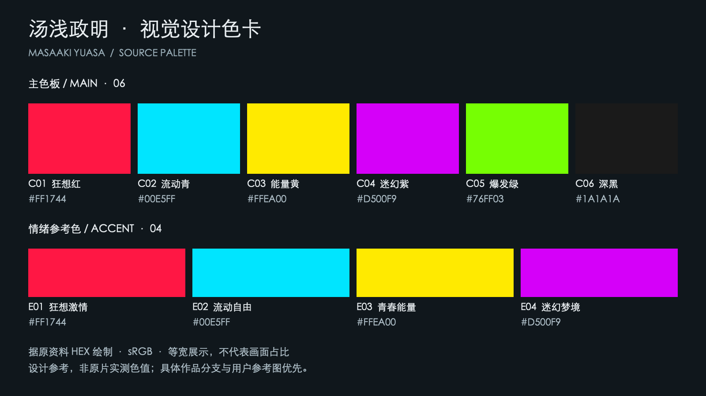

# 汤浅政明

**媒介：动画。核心机制：可控形变与线条节奏把身体感受转成空间变化。**

## 先选作品分支

《心灵游戏》：形变与主观空间；《四叠半神话大系》：图形化重复空间；《乒乓》：线条、身体和运动节奏。

## 转译为画面

- **空间与人物：**可控形变与线条节奏把身体感受转成空间变化。先确定人物位置、视线、动作起止和遮挡关系。
- **光色与材质：**选少量平涂色块，运动重点可改变轮廓与比例；不同分支不要套同一荧光彩虹。
- **使用边界：**后两者为剧集分支；有意形变必须指定部位和恢复状态，不能当成任意身份漂移。

## 原包色值参考

以下六色仅为原包设计参考，未经逐帧取色验证，不是导演固定参数。按作品和主体选择主、辅、强调色，说明承载物；不规定占比，不把肤色强制映射到色板。黑白分支忽略彩色参考，用户图片优先。

| 原包色名 | HEX |
|---|---|
| 狂想红 | `#FF1744` |
| 流动青 | `#00E5FF` |
| 能量黄 | `#FFEA00` |
| 迷幻紫 | `#D500F9` |
| 爆发绿 | `#76FF03` |
| 深黑 | `#1A1A1A` |

## 原创 showcase 起点

原创跑者迈过门槛时腿部轮廓短暂拉长，落地后恢复，房间透视只随这一步夸张。

这是创作提案，不是原片镜头。静帧只取一个可见瞬间；短视频优先围绕一个清楚事件和主导摄影机行为展开。用户需要且时长与能力支持时，可安排合理复合运镜或切镜，并明确衔接和结束状态。

## 来源定位

原包 `第3期_SKILL_动画柔光东方_141-200/08_动画奇幻与异想视觉/145_MasaakiYuasa_汤浅政明/色卡主文档.md`。仅抽取色名与色值；作品分支和视觉规则为整理转译，不沿用原包情绪色意义、固定光比或电影截图链接。见 [sources.md](sources.md) 的亚洲扩展说明。

## 可视化色卡与结构化数据

[PNG 色卡](../assets/color-palettes/masaaki-yuasa.png) · [SVG 矢量版](../assets/color-palettes/masaaki-yuasa.svg) · [JSON 色值](../assets/color-palettes/masaaki-yuasa.json)

包含原资料的 6 个主色与 4 个情绪参考色，按 HEX 确定性绘制，非原片逐帧实测。色块等宽仅为查看方便，不代表固定占比；情绪标签只保留原资料联想。使用规则及全库索引见 [色卡使用指南](color-palettes.md)。
