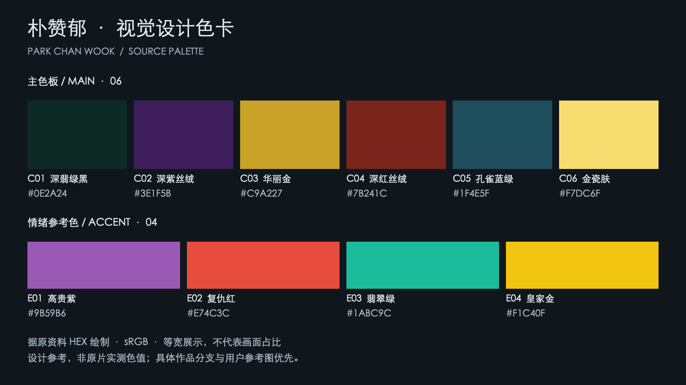

# 朴赞郁

**媒介：真人电影。核心机制：精密构图让物件、视线与遮挡成为线索。**

## 先选作品分支

《小姐》：室内装饰与窥视关系；《分手的决心》：山海、距离与观看；《老男孩》：封闭空间和身体压力。

## 转译为画面

- **空间与人物：**精密构图让物件、视线与遮挡成为线索。先确定人物位置、视线、动作起止和遮挡关系。
- **光色与材质：**深绿、木棕、暗红可由墙面织物承载；山海分支用雾灰与蓝绿，不强制绿紫金齐上。
- **使用边界：**保留原包色名但不把金色指定为肤色；不将所有作品做成华丽对称宫殿。

## 原包色值参考

以下六色仅为原包设计参考，未经逐帧取色验证，不是导演固定参数。按作品和主体选择主、辅、强调色，说明承载物；不规定占比，不把肤色强制映射到色板。黑白分支忽略彩色参考，用户图片优先。

| 原包色名 | HEX |
|---|---|
| 深翡绿黑 | `#0E2A24` |
| 深紫丝绒 | `#3E1F5B` |
| 华丽金 | `#C9A227` |
| 深红丝绒 | `#7B241C` |
| 孔雀蓝绿 | `#1F4E5F` |
| 金瓷肤 | `#F7DC6F` |

## 原创 showcase 起点

镜中人物合上首饰盒，门缝里的另一双手停住，摄影机只缓慢推进。

这是创作提案，不是原片镜头。静帧只取一个可见瞬间；短视频优先围绕一个清楚事件和主导摄影机行为展开。用户需要且时长与能力支持时，可安排合理复合运镜或切镜，并明确衔接和结束状态。

## 来源定位

原包 `第1期_SKILL_冷调与大地_001-080/01_黑色悬疑与冷调惊悚/017_ParkChan-wook_朴赞郁/色卡主文档.md`。仅抽取色名与色值；作品分支和视觉规则为整理转译，不沿用原包情绪色意义、固定光比或电影截图链接。见 [sources.md](sources.md) 的亚洲扩展说明。

## 可视化色卡与结构化数据

[PNG 色卡](../assets/color-palettes/park-chan-wook.png) · [SVG 矢量版](../assets/color-palettes/park-chan-wook.svg) · [JSON 色值](../assets/color-palettes/park-chan-wook.json)

包含原资料的 6 个主色与 4 个情绪参考色，按 HEX 确定性绘制，非原片逐帧实测。色块等宽仅为查看方便，不代表固定占比；情绪标签只保留原资料联想。使用规则及全库索引见 [色卡使用指南](color-palettes.md)。
