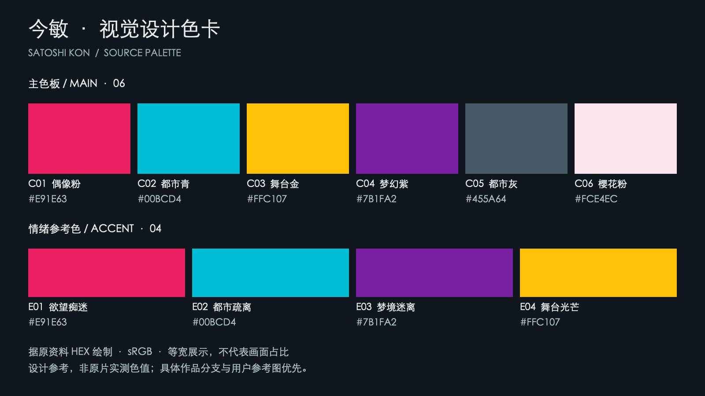

# 今敏

**媒介：动画。核心机制：通过匹配动作、反射与空间切换制造观看的不确定。**

## 先选作品分支

《未麻的部屋》：镜像与身份错位；《千年女优》：动作衔接跨越空间；《红辣椒》：现实与梦的边界。

## 转译为画面

- **空间与人物：**通过匹配动作、反射与空间切换制造观看的不确定。先确定人物位置、视线、动作起止和遮挡关系。
- **光色与材质：**现实场景先定稳定色彩，跨场景转接保留一个色彩或形状锚点。
- **使用边界：**静帧不能声称实现剪辑；复杂变换分成相邻关键帧，不做随机融化。

## 原包色值参考

以下六色仅为原包设计参考，未经逐帧取色验证，不是导演固定参数。按作品和主体选择主、辅、强调色，说明承载物；不规定占比，不把肤色强制映射到色板。黑白分支忽略彩色参考，用户图片优先。

| 原包色名 | HEX |
|---|---|
| 偶像粉 | `#E91E63` |
| 都市青 | `#00BCD4` |
| 舞台金 | `#FFC107` |
| 梦幻紫 | `#7B1FA2` |
| 都市灰 | `#455A64` |
| 樱花粉 | `#FCE4EC` |

## 原创 showcase 起点

人物在地铁窗前抬手，下一镜同一手势接到舞台侧幕，身份和手的位置保持一致。

这是创作提案，不是原片镜头。静帧只取一个可见瞬间；短视频优先围绕一个清楚事件和主导摄影机行为展开。用户需要且时长与能力支持时，可安排合理复合运镜或切镜，并明确衔接和结束状态。

## 来源定位

原包 `第3期_SKILL_动画柔光东方_141-200/08_动画奇幻与异想视觉/141_SatoshiKon_今敏/色卡主文档.md`。仅抽取色名与色值；作品分支和视觉规则为整理转译，不沿用原包情绪色意义、固定光比或电影截图链接。见 [sources.md](sources.md) 的亚洲扩展说明。

## 可视化色卡与结构化数据

[PNG 色卡](../assets/color-palettes/satoshi-kon.png) · [SVG 矢量版](../assets/color-palettes/satoshi-kon.svg) · [JSON 色值](../assets/color-palettes/satoshi-kon.json)

包含原资料的 6 个主色与 4 个情绪参考色，按 HEX 确定性绘制，非原片逐帧实测。色块等宽仅为查看方便，不代表固定占比；情绪标签只保留原资料联想。使用规则及全库索引见 [色卡使用指南](color-palettes.md)。
