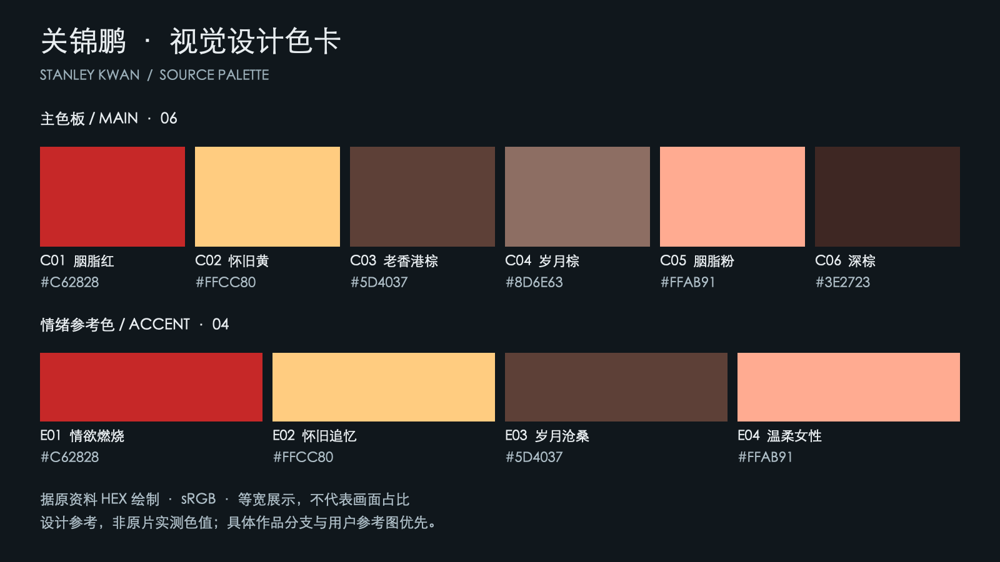

# 关锦鹏

**核心机制：人物凝视与室内物件承载爱情、身份和时代记忆。**

## 先选作品分支

《胭脂扣》：旧时空间与回望；《红玫瑰白玫瑰》：服饰与室内欲望；《阮玲玉》：表演与影像记忆；《蓝宇》：现代日常和克制亲密。

## 转译为画面

- **构图与空间：**以镜面、门窗和室内距离组织人物关系；服饰和陈设表现身份，但不压过表演。
- **光线与材质：**怀旧分支用胭脂、深棕和柔暖灯光；《蓝宇》允许灰蓝、冷白和自然肤色。
- **人物与时间：**停留在听者表情、物件触碰和未说出口的反应，镜头移动为人物关系服务。
- **避免误用：**不要把所有作品都改成老上海女性群像；保留现代题材的日常尺度。

以上是依据资料整理的创作方法，不是每部作品都适用的摄影定律。选择一个分支，再根据用户主体组合特征。

## 原包色值参考

下列色名与 HEX 来自原包色板，仅作设计锚点；未经本次逐帧采样验证。挑选主色、辅色和少量强调色，写清颜色承载的物体，不同时塞满全部色彩。作品分支与用户参考图优先于通用色板。

| 原包色名 | HEX |
|---|---|
| 胭脂红 | `#C62828` |
| 怀旧黄 | `#FFCC80` |
| 老香港棕 | `#5D4037` |
| 岁月棕 | `#8D6E63` |
| 胭脂粉 | `#FFAB91` |
| 深棕 | `#3E2723` |

## 来源定位

原包条目 `第3期_SKILL_动画柔光东方_141-200/09_浪漫柔光与复古色调/165_StanleyKwan_关锦鹏` 的 `色卡主文档.md`、`assets/color_palettes/palette.json` 与提示词文件。来源边界及勘误见 [sources.md](sources.md)。

## 可视化色卡与结构化数据

[PNG 色卡](../assets/color-palettes/stanley-kwan.png) · [SVG 矢量版](../assets/color-palettes/stanley-kwan.svg) · [JSON 色值](../assets/color-palettes/stanley-kwan.json)

包含原资料的 6 个主色与 4 个情绪参考色，按 HEX 确定性绘制，非原片逐帧实测。色块等宽仅为查看方便，不代表固定占比；情绪标签只保留原资料联想。使用规则及全库索引见 [色卡使用指南](color-palettes.md)。
