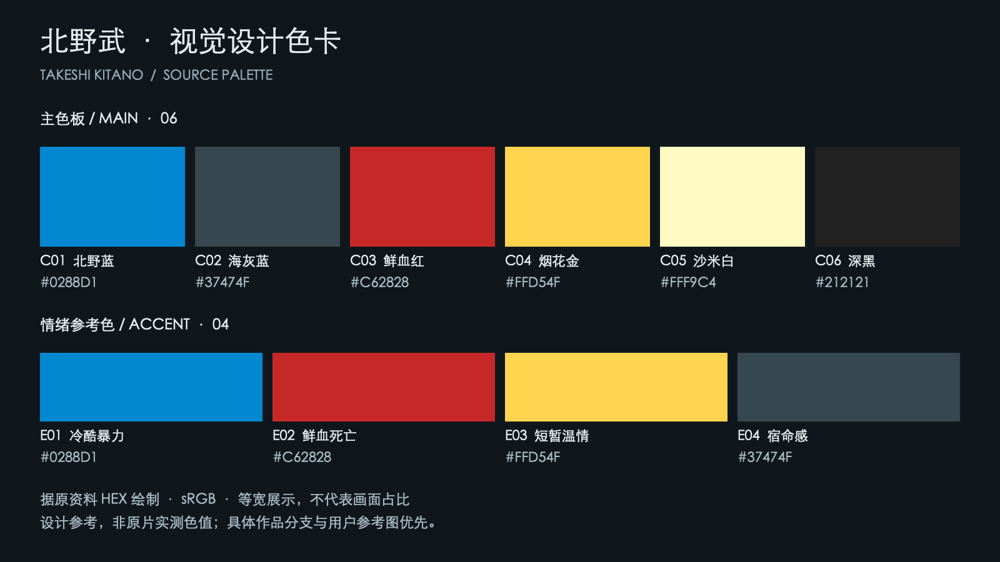

# 北野武

**媒介：真人电影。核心机制：静止的横向空间和突发的小动作形成反差。**

## 先选作品分支

《奏鸣曲》《花火》：静止人物、海岸与突然动作；《菊次郎的夏天》：夏日道路与游戏。

## 转译为画面

- **空间与人物：**静止的横向空间和突发的小动作形成反差。先确定人物位置、视线、动作起止和遮挡关系。
- **光色与材质：**海灰蓝用于海天和阴影，沙白用于岸线；夏日分支允许自然绿色和暖光。
- **使用边界：**不把所有作品套上蓝色滤镜，不用无表情替代人物行为。

## 原包色值参考

以下六色仅为原包设计参考，未经逐帧取色验证，不是导演固定参数。按作品和主体选择主、辅、强调色，说明承载物；不规定占比，不把肤色强制映射到色板。黑白分支忽略彩色参考，用户图片优先。

| 原包色名 | HEX |
|---|---|
| 北野蓝 | `#0288D1` |
| 海灰蓝 | `#37474F` |
| 鲜血红 | `#C62828` |
| 烟花金 | `#FFD54F` |
| 沙米白 | `#FFF9C4` |
| 深黑 | `#212121` |

## 原创 showcase 起点

海堤上两人隔开坐着，一人放走一只纸飞机，另一人仍望向海面。

这是创作提案，不是原片镜头。静帧只取一个可见瞬间；短视频优先围绕一个清楚事件和主导摄影机行为展开。用户需要且时长与能力支持时，可安排合理复合运镜或切镜，并明确衔接和结束状态。

## 来源定位

原包 `第3期_SKILL_动画柔光东方_141-200/10_东方美学与留白意境/184_TakeshiKitano_北野武/色卡主文档.md`。仅抽取色名与色值；作品分支和视觉规则为整理转译，不沿用原包情绪色意义、固定光比或电影截图链接。见 [sources.md](sources.md) 的亚洲扩展说明。

## 可视化色卡与结构化数据

[PNG 色卡](../assets/color-palettes/takeshi-kitano.png) · [SVG 矢量版](../assets/color-palettes/takeshi-kitano.svg) · [JSON 色值](../assets/color-palettes/takeshi-kitano.json)

包含原资料的 6 个主色与 4 个情绪参考色，按 HEX 确定性绘制，非原片逐帧实测。色块等宽仅为查看方便，不代表固定占比；情绪标签只保留原资料联想。使用规则及全库索引见 [色卡使用指南](color-palettes.md)。
