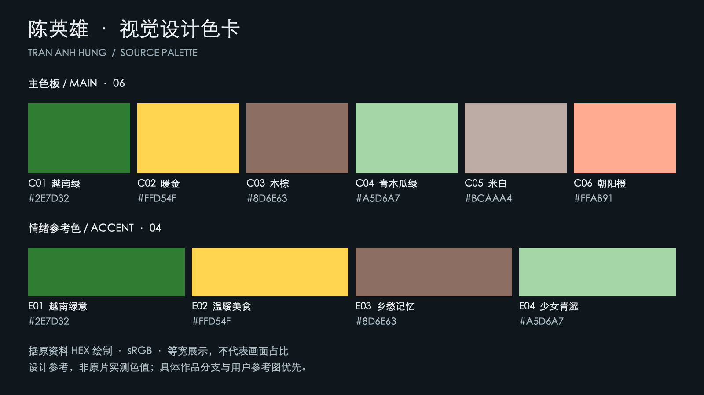

# 陈英雄

**媒介：真人电影。核心机制：植物、器皿与身体动作通过细密材质建立感官空间。**

## 先选作品分支

《青木瓜之味》：庭院、植物与日常劳动；《夏天的滋味》：潮湿光线与身体距离；《三轮车夫》：城市压迫。

## 转译为画面

- **空间与人物：**植物、器皿与身体动作通过细密材质建立感官空间。先确定人物位置、视线、动作起止和遮挡关系。
- **光色与材质：**绿叶、旧木、浅色织物承载配色，侧光显出水珠和蒸汽；城市分支可更暗更硬。
- **使用边界：**不把所有作品做成美食或热带绿色；不把普通生活拍成摆拍产品广告。

## 原包色值参考

以下六色仅为原包设计参考，未经逐帧取色验证，不是导演固定参数。按作品和主体选择主、辅、强调色，说明承载物；不规定占比，不把肤色强制映射到色板。黑白分支忽略彩色参考，用户图片优先。

| 原包色名 | HEX |
|---|---|
| 越南绿 | `#2E7D32` |
| 暖金 | `#FFD54F` |
| 木棕 | `#8D6E63` |
| 青木瓜绿 | `#A5D6A7` |
| 米白 | `#BCAAA4` |
| 朝阳橙 | `#FFAB91` |

## 原创 showcase 起点

院落厨房里，一双手将洗净的叶菜放入竹筛，窗外叶影缓慢移动。

这是创作提案，不是原片镜头。静帧只取一个可见瞬间；短视频优先围绕一个清楚事件和主导摄影机行为展开。用户需要且时长与能力支持时，可安排合理复合运镜或切镜，并明确衔接和结束状态。

## 来源定位

原包 `第3期_SKILL_动画柔光东方_141-200/10_东方美学与留白意境/191_TranAnhHung_陈英雄/色卡主文档.md`。仅抽取色名与色值；作品分支和视觉规则为整理转译，不沿用原包情绪色意义、固定光比或电影截图链接。见 [sources.md](sources.md) 的亚洲扩展说明。

## 可视化色卡与结构化数据

[PNG 色卡](../assets/color-palettes/tran-anh-hung.png) · [SVG 矢量版](../assets/color-palettes/tran-anh-hung.svg) · [JSON 色值](../assets/color-palettes/tran-anh-hung.json)

包含原资料的 6 个主色与 4 个情绪参考色，按 HEX 确定性绘制，非原片逐帧实测。色块等宽仅为查看方便，不代表固定占比；情绪标签只保留原资料联想。使用规则及全库索引见 [色卡使用指南](color-palettes.md)。
