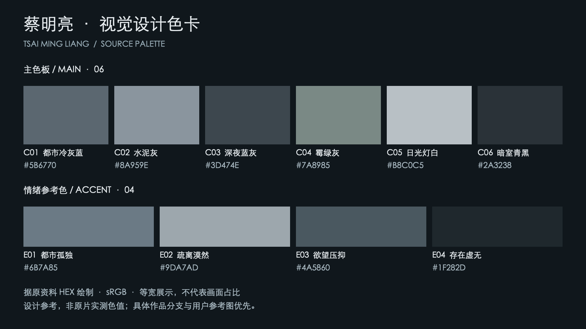

# 蔡明亮

**核心机制：停留的身体与空房间让时间变得可感。**

## 先选作品分支

《爱情万岁》：空屋与孤独身体；《河流》：室内、水与压迫；《郊游》：城市边缘和持续凝视。

## 转译为画面

- **构图与空间：**固定中远景，门框、楼梯和空白面积保留人与空间的疏离；不要急着靠特写解释情绪。
- **光线与材质：**冷白灯、灰蓝水泥、低照度空间；水渍或积水必须与场景有关，不作为装饰通用添加。
- **人物与时间：**维持固定视点，让坐、等、吃、呼吸或细小重复动作承担时间；短视频只截取一个持续片段。
- **避免误用：**并非所有作品都冷灰；不以频繁切镜、煽情配乐或无目的推拉替代停留。

以上是依据资料整理的创作方法，不是每部作品都适用的摄影定律。选择一个分支，再根据用户主体组合特征。

## 原包色值参考

下列色名与 HEX 来自原包色板，仅作设计锚点；未经本次逐帧采样验证。挑选主色、辅色和少量强调色，写清颜色承载的物体，不同时塞满全部色彩。作品分支与用户参考图优先于通用色板。

| 原包色名 | HEX |
|---|---|
| 都市冷灰蓝 | `#5B6770` |
| 水泥灰 | `#8A959E` |
| 深夜蓝灰 | `#3D474E` |
| 霉绿灰 | `#7A8985` |
| 日光灯白 | `#B8C0C5` |
| 暗室青黑 | `#2A3238` |

## 来源定位

原包条目 `第1期_SKILL_冷调与大地_001-080/04_极简冷构与静观长镜/065_TsaiMing-liang_蔡明亮` 的 `色卡主文档.md`、`assets/color_palettes/palette.json` 与提示词文件。来源边界及勘误见 [sources.md](sources.md)。

## 可视化色卡与结构化数据

[PNG 色卡](../assets/color-palettes/tsai-ming-liang.png) · [SVG 矢量版](../assets/color-palettes/tsai-ming-liang.svg) · [JSON 色值](../assets/color-palettes/tsai-ming-liang.json)

包含原资料的 6 个主色与 4 个情绪参考色，按 HEX 确定性绘制，非原片逐帧实测。色块等宽仅为查看方便，不代表固定占比；情绪标签只保留原资料联想。使用规则及全库索引见 [色卡使用指南](color-palettes.md)。
