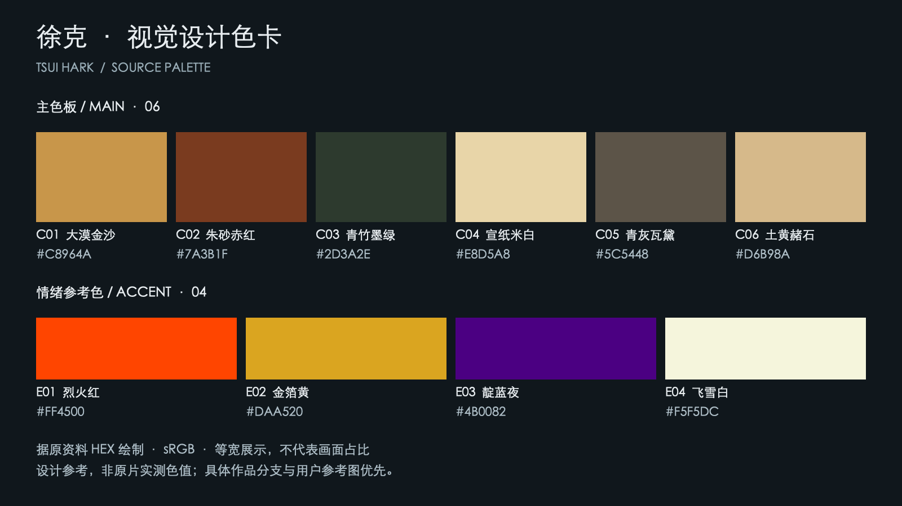

# 徐克

**核心机制：身体、兵器、建筑与运动方向共同组织奇观。**

## 先选作品分支

《黄飞鸿》：街巷与群体动作；《青蛇》：湿润、流动、妖异色光；《龙门飞甲》：沙尘与纵深；《七剑》：寒冷粗粝的武侠空间。

## 转译为画面

- **构图与空间：**低机位、斜线和多层前景建立攻防；先明确双方位置、出入口、兵器方向，再安排夸张动作。
- **光线与材质：**按分支选木棕布蓝、青绿湿光、沙黄或雪灰；逆光用于显出尘、纱或水的运动。
- **人物与时间：**静帧选蓄势、交锋或落地中的一瞬；视频拆清起势—接触—反应—落点，运动与剪辑服务空间关系。
- **避免误用：**不固定每秒切镜数，不把所有武侠都做成飘逸慢动作；《新龙门客栈》应标为徐克监制、李惠民导演的关联参考。

以上是依据资料整理的创作方法，不是每部作品都适用的摄影定律。选择一个分支，再根据用户主体组合特征。

## 原包色值参考

下列色名与 HEX 来自原包色板，仅作设计锚点；未经本次逐帧采样验证。挑选主色、辅色和少量强调色，写清颜色承载的物体，不同时塞满全部色彩。作品分支与用户参考图优先于通用色板。

| 原包色名 | HEX |
|---|---|
| 大漠金沙 | `#C8964A` |
| 朱砂赤红 | `#7A3B1F` |
| 青竹墨绿 | `#2D3A2E` |
| 宣纸米白 | `#E8D5A8` |
| 青灰瓦黛 | `#5C5448` |
| 土黄赭石 | `#D6B98A` |

## 来源定位

原包条目 `第1期_SKILL_冷调与大地_001-080/03_大地暖调与自然光诗意/055_Tsui Hark_徐克` 的 `色卡主文档.md`、`assets/color_palettes/palette.json` 与提示词文件。来源边界及勘误见 [sources.md](sources.md)。

## 可视化色卡与结构化数据

[PNG 色卡](../assets/color-palettes/tsui-hark.png) · [SVG 矢量版](../assets/color-palettes/tsui-hark.svg) · [JSON 色值](../assets/color-palettes/tsui-hark.json)

包含原资料的 6 个主色与 4 个情绪参考色，按 HEX 确定性绘制，非原片逐帧实测。色块等宽仅为查看方便，不代表固定占比；情绪标签只保留原资料联想。使用规则及全库索引见 [色卡使用指南](color-palettes.md)。
