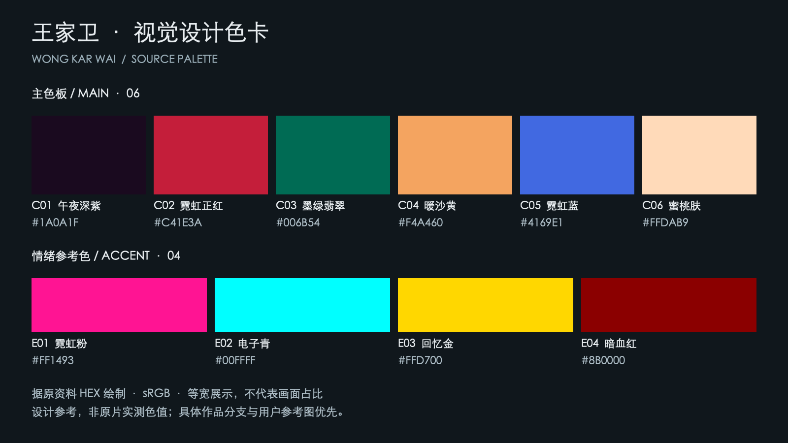

# 王家卫

**核心机制：遮挡与错位让亲密关系变得不可抵达。**

## 先选作品分支

《花样年华》：走廊、门框、织物与克制停顿；《重庆森林》：日常都市、多色物件、混合照明与按场景选用的运动拖影；《堕落天使》：近距离广角、夜色与疏离。

涉及《重庆森林》或《花样年华》的色彩、质感与画面设计时，必读 [用户参考图的场景级补充](wong-kar-wai-user-studies.md)：两组分别整理，不合并成通用王家卫滤镜。该补充基于用户确认的网络图片观察，按对应场景优先于下方旧色板；本次任务新参考仍优先。

## 转译为画面

- **构图与空间：**让门框切去部分身体，人物与镜中映像分层；用走廊或玻璃制造看见却无法接近的距离。
- **光线与材质：**按作品和场景组织物体色彩、混合照明与冷暖分区，保留肤色和暗部差异；红既可作为小色块，也可由帘幕构成大面积主色。绿色不自动等于霓虹，不从截图断言灯具或胶片工艺。
- **人物与时间：**静帧抓擦肩前后的停顿；视频可缓慢横移或跟随，只有运动分支使用拖影，不把步印当运镜。
- **避免误用：**不要把所有作品变成红绿赛博雨夜；《花样年华》不必使用《堕落天使》的极端广角。

以上是依据资料整理的创作方法，不是每部作品都适用的摄影定律。选择一个分支，再根据用户主体组合特征。

## 代表性示例与人物设计

使用下列方案时标注“原创视觉方案，参考作品视觉语言”，不能称为原片截图。来源见 [研究记录](research-five-directors.md)。以下构图、配色和选角是创作转译，不是导演固定参数。

| 作品分支 | 景别与构图建议 | 色彩与光源落点 | 人物选择与表演建议 |
|---|---|---|---|
| 《花样年华》 | 中景／中全景，隔门框观看；前景遮挡、中景人物、后景狭窄通道；两人靠近但视线错开 | 按场景选择红棕卡座与浅绿、青绿办公室、黄绿夜街或浓红帘幕；保留织物、皮革、肤色与暗部差异 | 与1960年代香港语境相符的成年人物；合身旗袍或整洁衬衫西装，克制梳妆；肩颈姿态、手部停顿、避开的眼神比正面摆拍重要 |
| 《重庆森林》 | 日常店铺、柜台、市场与玻璃反射；用前后层次和视线组织关系，不默认极端广角 | 暖黄店内、明黄衣物与绿反射、灰蓝人物与暖水果摊、蓝白金属与红黄用品等按场景选择；局部浓色而非全局高饱和 | 遵循任务身份与时代；日常动作、轻快停顿或穿行，运动拖影仅按场景选用，不复制演员造型 |
| 《堕落天使》 | 近距离广角的中近景，让前景人物变大、身后狭小店铺被拉长；边缘人物与深处另一人构成距离 | 夜间店内偏绿光、暗墙、少量暖招牌反光；不要全幅均匀红蓝染色 | 年轻成年都市夜行者，短发或凌乱发丝、便于行动的街头衣着；疲惫、警觉或突兀的身体姿态，区别于前一分支的端正礼仪 |

**示例A：走廊擦肩后的停顿。** 中全景，镜头在半开的门后。一位穿花纹旗袍的成年女性拿着饭盒停在走廊近端，另一位穿衬衫的成年男性在深处侧身让路；门框切开两人的位置。暖壁灯照亮衣料，背景灰绿，暗红在本例中只占局部（不是全片规则，浓红帘幕场景可由红色主导）。重点是空间遮挡和未完成的交流，不是旗袍写真。

**示例B：深夜小店的距离。** 近距离广角中近景，一位夜班青年倚在柜台边，另一人留在店铺深处；柜台斜线放大两者距离。荧光灯、旧金属和玻璃反射构成色光，姿态松散而目光紧张。不要把极端透视搬入示例A。

选角不要求像梁朝伟、张曼玉等演员；优先人物气质、时代造型和微表情。用户有参考人物时保留身份特征。《重庆森林》可另走轻快、拥挤的日常都市分支，不能统一成沉重夜景。不同发行／修复版本的色彩与画幅可能不同，匹配具体参考的色彩倾向时须先明确所依据的图片；无法确定发行版本时标注未知，不将其色偏推广到全片。

## 原包色值参考

下列色名与 HEX 来自原包色板，仅作设计锚点；未经本次逐帧采样验证。挑选主色、辅色和少量强调色，写清颜色承载的物体，不同时塞满全部色彩。作品分支、用户参考图及对应场景补充优先于通用色板。下列霓虹色名不是默认调色配方，未匹配具体场景时不要直接套用。

| 原包色名 | HEX |
|---|---|
| 午夜深紫 | `#1A0A1F` |
| 霓虹正红 | `#C41E3A` |
| 墨绿翡翠 | `#006B54` |
| 暖沙黄 | `#F4A460` |
| 霓虹蓝 | `#4169E1` |
| 蜜桃肤 | `#FFDAB9` |

## 来源定位

原包条目 `第1期_SKILL_冷调与大地_001-080/02_霓虹黑色与赛博未来/022_WongKar-wai_王家卫` 的 `色卡主文档.md`、`assets/color_palettes/palette.json` 与提示词文件。来源边界及勘误见 [sources.md](sources.md)。

## 可视化色卡与结构化数据

[PNG 色卡](../assets/color-palettes/wong-kar-wai.png) · [SVG 矢量版](../assets/color-palettes/wong-kar-wai.svg) · [JSON 色值](../assets/color-palettes/wong-kar-wai.json)

包含原资料的 6 个主色与 4 个情绪参考色，按 HEX 确定性绘制，非原片逐帧实测。色块等宽仅为查看方便，不代表固定占比；情绪标签只保留原资料联想。使用规则及全库索引见 [色卡使用指南](color-palettes.md)。
