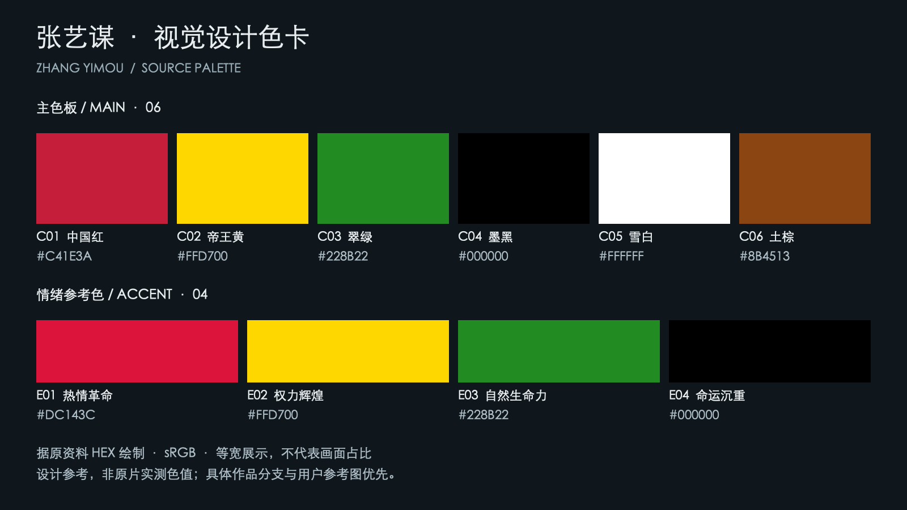

# 张艺谋

**核心机制：色块、轴线与群体秩序共同表达权力和个体处境。**

## 先选作品分支

《大红灯笼高高挂》：院落秩序与灯笼红；《英雄》：按场景组织主辅色、人物尺度与空间秩序；《影》：黑白灰、水与材质；《红高粱》：土地、身体与浓烈生命感。

涉及《英雄》的色彩、质感、人物尺度与构图时，必读 [用户参考图的场景级补充](zhang-yimou-hero-user-studies.md)。按九类场景选择色彩与空间关系，网络截图观察不等于全片唯一标准；本次任务新参考优先。

## 转译为画面

- **构图与空间：**用院落中轴、重复门窗、队列或人物大小关系组织画面，明确个人如何偏离秩序。
- **光线与材质：**主色落在服装、布幔、墙面或环境中；《影》保留水墨灰阶与真实肌理，不能强加红金。
- **人物与时间：**仪式分支用进入、站定、转身等清晰动作；动作分支将身体轨迹与大色块呼应。
- **避免误用：**色彩不是全画面染色；不把中国红、金色、对称套给所有作品和场景。

以上是依据资料整理的创作方法，不是每部作品都适用的摄影定律。选择一个分支，再根据用户主体组合特征。

## 代表性示例与人物设计

来源见 [研究记录](research-five-directors.md)。以下为原创方案建议，不是原片镜头复述；色彩意义依作品与段落变化，不设置“红色永远代表某情绪”的字典。

| 作品分支 | 景别与构图建议 | 色彩与光源落点 | 人物选择与表演建议 |
|---|---|---|---|
| 《大红灯笼高高挂》 | 全景／远景，院落、重复门窗和轴线控制人物位置；人物可小于建筑，不必每次严格居中 | 灰砖、暗瓦、红灯笼及其局部暖光；红色有具体礼仪位置 | 与故事时代相符的成年女性、家族成员或侍从；衣料与站位区分身份，身体收束、表情有压力；不默认宫廷华服或性感摆拍 |
| 《英雄》 | 按场景选择中轴、环形、斜向、自然曲线或横向层叠；人物尺度、衣袖、环境与空密关系共同组织画面 | 选定主色及有载体的对照色，如蓝水与红叶、金黄树林与红衣；也可冷灰或土褐。肤色按景别和受光处理，不全幅染色、不将各段拼成彩虹 | 有身体控制力的成年武者，重心、手臂和衣袍方向明确；不同性别均按角色设计，避免只靠明星脸和兵器识别 |

**示例A：院落里的等待。** 略高机位远景，灰砖院落与两侧房门形成重复几何，一名成年女性停在侧院门槛；红灯笼集中于另一侧，视觉上显出待遇与距离。人物服饰低调而合时代，表情无需被特写放大，孤立位置已传达处境。

**示例B：蓝色段落的对峙。** 全景，两个穿深浅蓝衣的成年武者隔着大片冷灰地面相对，衣袍构成明确色块，身体重心沉稳；自然漫射光保留衣纹与脸部细节。此为参照《英雄》色彩叙事机制的新设计，不声称对应原片具体场面。

其他分支按用户需求保留：《红高粱》重土地、身体与生命力；《影》重黑白灰材质。不要用上述两个分支代表全部作品，也不要把“强烈色彩”误解成过饱和滤镜。人物外貌没有本次证据可支持的固定脸型标准。

## 原包色值参考

下列色名与 HEX 来自原包色板，仅作设计锚点；未经本次逐帧采样验证。挑选主色、辅色和少量强调色，写清颜色承载的物体，不同时塞满全部色彩。作品分支、用户参考图及对应场景补充优先于通用色板。《英雄》的主色不排斥有明确主次的对照色；下列中国红、帝王黄等色名不是其全片默认配方。

| 原包色名 | HEX |
|---|---|
| 中国红 | `#C41E3A` |
| 帝王黄 | `#FFD700` |
| 翠绿 | `#228B22` |
| 墨黑 | `#000000` |
| 雪白 | `#FFFFFF` |
| 土棕 | `#8B4513` |

## 来源定位

原包条目 `第2期_SKILL_浓彩与梦幻_081-140/05_巴洛克华丽与浓墨重彩/086_ZhangYimou_张艺谋` 的 `色卡主文档.md`、`assets/color_palettes/palette.json` 与提示词文件。来源边界及勘误见 [sources.md](sources.md)。

## 可视化色卡与结构化数据

[PNG 色卡](../assets/color-palettes/zhang-yimou.png) · [SVG 矢量版](../assets/color-palettes/zhang-yimou.svg) · [JSON 色值](../assets/color-palettes/zhang-yimou.json)

包含原资料的 6 个主色与 4 个情绪参考色，按 HEX 确定性绘制，非原片逐帧实测。色块等宽仅为查看方便，不代表固定占比；情绪标签只保留原资料联想。使用规则及全库索引见 [色卡使用指南](color-palettes.md)。
